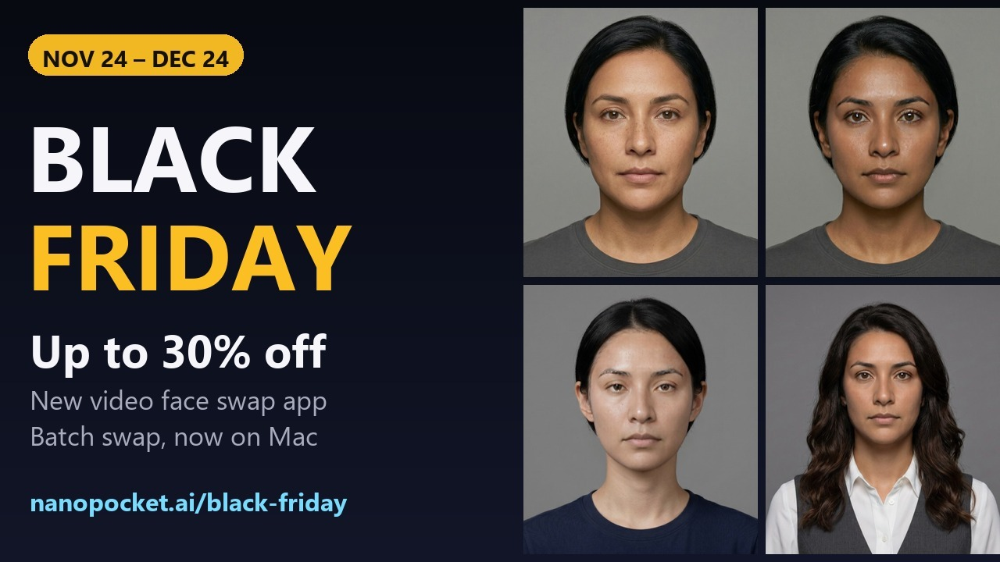
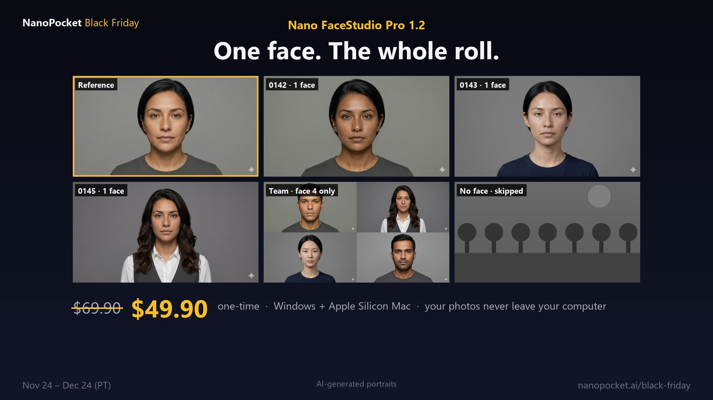
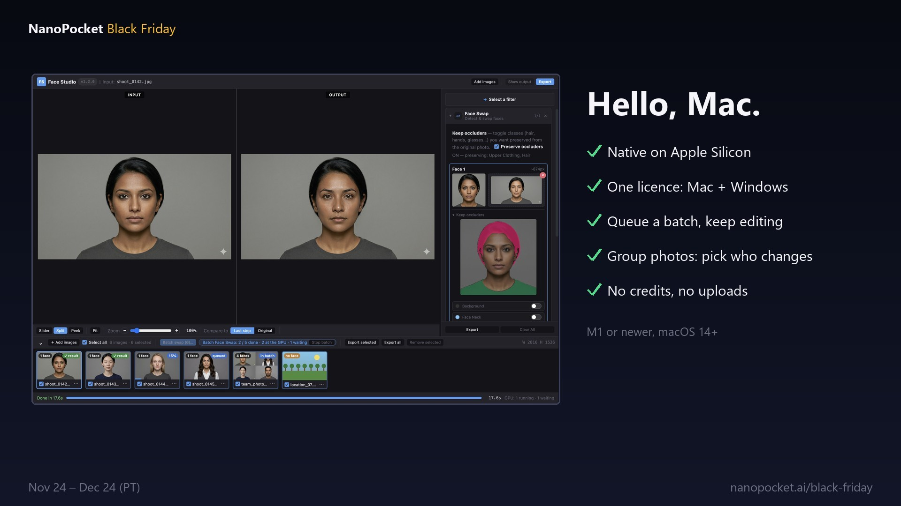
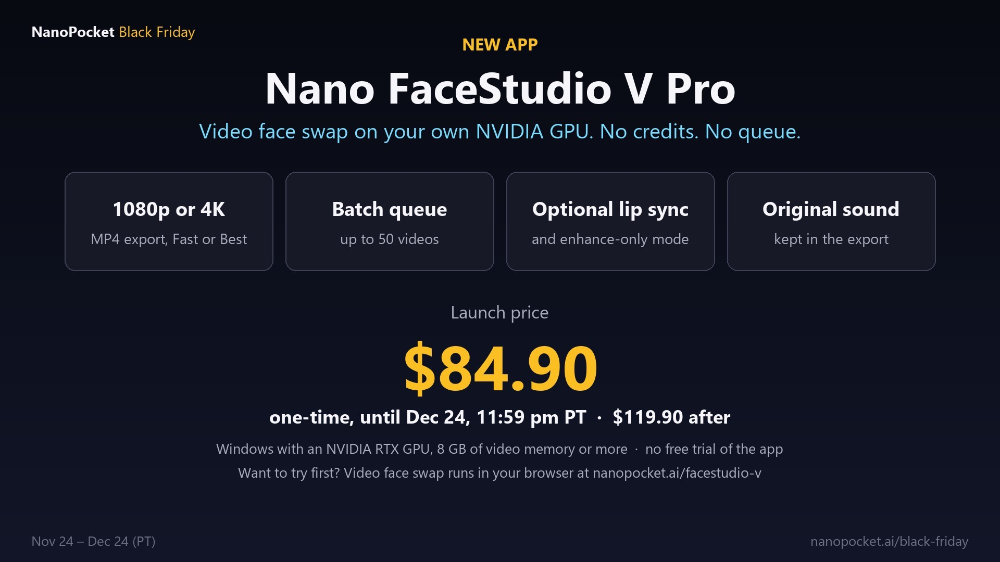
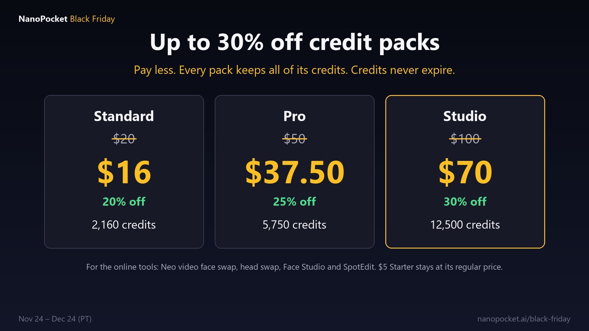
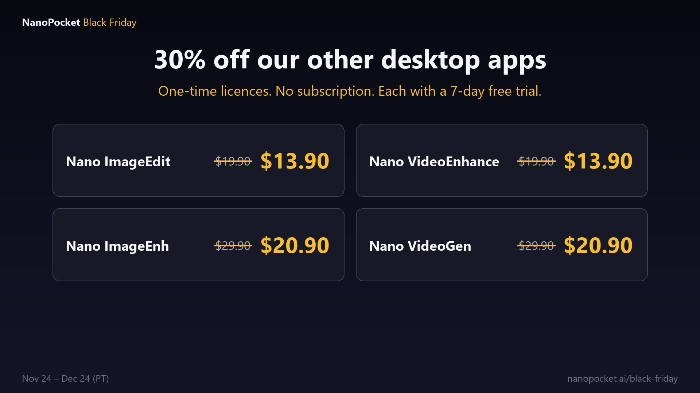

# NanoPocket · Black Friday at NanoPocket – A Whole Month of Offers

### Nov 24 to Dec 24 (PT). A new video face swap app, batch swap on Mac, and up to 30% off. No code to enter.

      

## 🎬 Demo video

▶️ **[Watch on YouTube](https://youtu.be/QzerheSxoDw)**

## ✨ About NanoPocket Black Friday

Black Friday at NanoPocket runs for a whole month, from Nov 24, 12:00 am PT to Dec 24, 11:59 pm PT. Every offer applies on its own at checkout, with no code to enter. This year it comes with two releases: Nano FaceStudio Pro 1.2, which swaps one face across a whole shoot and now runs natively on Apple Silicon Macs, and Nano FaceStudio V Pro, our new desktop app for video face swap on your own NVIDIA GPU.

- Nano FaceStudio Pro 1.2: $49.90 one-time (regular $69.90). Batch face swap, group photos, Windows and Apple Silicon Mac, and your photos stay on your computer
- New app, Nano FaceStudio V Pro: $84.90 launch price until Dec 24, $119.90 after. Video face swap on your own NVIDIA RTX GPU, 1080p or 4K, no credits and no queue
- Credit packs: Standard $16 (was $20), Pro $37.50 (was $50), Studio $70 (was $100). Every pack keeps all of its credits, and credits never expire
- Neo launch week: Neo videos cost 30% fewer credits until Nov 27, 7 pm PT, and this stacks with the credit pack discount
- 30% off the other desktop apps: Nano ImageEdit and Nano VideoEnhance $13.90 (were $19.90), Nano ImageEnh and Nano VideoGen $20.90 (were $29.90)

## 🚀 Try it now

- **See All Black Friday Offers: [nanopocket.ai/black-friday](https://nanopocket.ai/black-friday)**
- **Nano FaceStudio Pro 1.2: [nanopocket.ai/apps/nano-facestudio-pro-1-2](https://nanopocket.ai/apps/nano-facestudio-pro-1-2)**
- **Nano FaceStudio V Pro: [nanopocket.ai/apps/nano-facestudio-v-pro](https://nanopocket.ai/apps/nano-facestudio-v-pro)**
- **Credit packs: [nanopocket.ai/credits](https://nanopocket.ai/credits)**
- **Try Neo: [nanopocket.ai/neo](https://nanopocket.ai/neo)**

## 🖼 Highlights

<table><tr><td align="center" valign="top" width="50%"> <b>Nano FaceStudio Pro 1.2: one face, the whole roll</b></td><td align="center" valign="top" width="50%"> <b>Now native on Apple Silicon Macs</b></td></tr></table>

<table><tr><td align="center" valign="top" width="50%"> <b>New app: Nano FaceStudio V Pro</b></td><td align="center" valign="top" width="50%"> <b>Up to 30% off credit packs</b></td></tr></table>

<table><tr><td align="center" valign="top" width="50%"> <b>30% off the other desktop apps</b></td></tr></table>

## 🏢 About NanoPocket

NanoPocket builds generative AI creative tools for images, video and faces. Use them online in your browser, or as desktop apps that run 100% locally on your own GPU, so your data never leaves your machine. The suite covers AI photo retouching, video face swap and head swap, facial editing, virtual try-on, image generation and editing, image and video upscaling, and AI video generation.

## 🔗 Links

- **Website:** https://nanopocket.ai
- **Download:** https://nanopocket.ai/download
- **Hugging Face:** https://huggingface.co/Nanopocket-ai
- **YouTube:** https://www.youtube.com/@NanoPocket_ai
- **GitHub:** https://github.com/Nanopocket-ai
- **Contact:** tech@nanopocket.ai

---

Prices are in US dollars. Sale prices apply to purchases made from Nov 24, 12:00 am PT to Dec 24, 11:59 pm PT; earlier purchases are not repriced. The $5 Starter pack keeps its regular price. $84.90 is the launch price of Nano FaceStudio V Pro, not a discount from an earlier price, and the app has no free trial. Portraits in the FaceStudio Pro examples are AI-generated; Neo and SpotEdit clips use stock footage and photos. Use only faces and photos you have the right to use.

© 2026 NanoPocket. All rights reserved. Synced automatically from https://nanopocket.ai.
